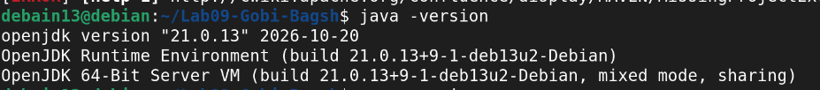
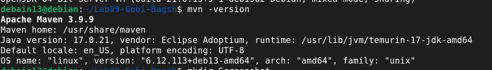

# Лаборатори №9 — JaCoCo код хамралт

**Оюутан:** Таны нэр
**Оюутны код:** Таны код
**Хичээл:** F.CSA313 — Программ хангамжийн чанарын баталгаа ба тест 

---

## Орчны хувилбар

### `java -version`

21.0.12.1

### `mvn -version`

Apache Maven 3.9.9

---

## Хэсэг A — Happy path тестүүд ба эхний хэмжилт

### Бичсэн тестүүд (5 тест)

| # | Тест | Хүлээлт |
|---|------|---------|
| 1 | `letterGrade_A` | `letterGrade(95) = "A"` |
| 2 | `letterGrade_B` | `letterGrade(85) = "B"` |
| 3 | `gpa_twoScores` | `gpa([95, 85]) = 3.5` |
| 4 | `gpa_average` | `gpa([95, 75]) = 3.0` |
| 5 | `scholarship_full` | `scholarship(3.9, 16, false) = 100` |

**Тестийн үр дүн:** `Tests run: 5, Failures: 0, Errors: 0, Skipped: 0` → **BUILD SUCCESS**

### Анхны хамралтын үзүүлэлт (`results/jacoco-A.csv`)

| Хэмжигдэхүүн | Хамрагдсан (COVERED) | Хамрагдаагүй (MISSED) | Нийт | Хамралт % |
|--------------|---------------------|----------------------|------|-----------|
| Instruction  | 104                 | 48                   | 152  | **68.4%** |
| Branch       | 20                  | 21                   | 41   | **48.8%** |
| Line         | 16                  | 9                    | 25   | **64.0%** |
| Method       | 4                   | 0                    | 4    | **100.0%**|
| Complexity   | 9                   | 17                   | 26   | **34.6%** |

**Томьёо:** `COVERED / (COVERED + MISSED) × 100`
- Branch: `20 / (20 + 21) × 100 = 20/41 = 48.78% ≈ 48.8%`
- Line: `16 / (16 + 9) × 100 = 16/25 = 64.0%`
- Instruction: `104 / (104 + 48) × 100 = 104/152 = 68.42% ≈ 68.4%`

> Page 9-ийн хүлээлттэй таарч байна: Line ≈60%, Branch ≈50% ✓

### Шар ромбо ба улаан мөрүүдийн ажиглалт

**Шар ромбо (хагас хамрагдсан салаанууд):**

- `letterGrade()` доторх `if (score < 0 || score > 100)` — зөвхөн `false` салаа хамрагдсан (хэвийн оноо), харин `true` салаа (exception шидэх) хүрээгүй. Мөн `||` операторын 2 нөхцөл тус бүрийн үнэн утга хүрээгүй.
- `gpa()` доторх `if (scores == null || scores.length == 0)` — зөвхөн `false` салаа л хамрагдсан, `||`-ийн хоёр нөхцөл тусдаа шалгагдаагүй.
- `gpa()` доторх `switch`-ийн `case "D"` ба `default` (F) салаанууд хүрээгүй.
- `scholarship()` доторх `if (hasViolation)` — `true` салаа хүрээгүй (зөрчилтэй кейс тестлээгүй).
- `scholarship()` доторх `gpa >= 3.8 && credits >= 15` — `credits >= 15` нөхцлийн `false` утга хүрээгүй.
- `scholarship()` доторх `gpa >= 3.4 && credits >= 12` — хоёр нөхцлийн аль аль `false` салаа хүрээгүй.
- `scholarship()` доторх `gpa >= 3.0` — `false` салаа (доод тэтгэлэг 0) хүрээгүй.

**Улаан мөр (огт хүрээгүй алдааны замууд):**

- `letterGrade()` дахь `throw new IllegalArgumentException(...)` мөр — 0-ээс бага, 100-аас их онооны кейс тестлээгүй.
- `gpa()` дахь `throw new IllegalArgumentException(...)` мөр — `null` эсвэл хоосон массив тестлээгүй.
- `scholarship()` дахь `throw new IllegalArgumentException(...)` мөр — сөрөг gpa, 4-өөс их gpa, сөрөг кредитийн кейс тестлээгүй.
- `gpa()` доторх `case "D": total += 1;` — D үсгэн дүнтэй оноо тестлээгүй.
- `scholarship()` доторх `return 70;`, `return 50;`, `return 0;` мөрүүд — холбогдох нөхцлүүд хүрээгүй.

---

## Хэсэг B — CFG ба Branch 100%

### CFG (`cfg.png`)

`scholarship()` функцын CFG-ийг гараар зурж, зангилаа (дугуй) ба ирмэг (сум) бүрийг Лекц 9-ийн хэв маягаар тэмдэглэсэн. Ирмэг бүрийн хажууд түүнийг дайрч буй **тестийн нэрийг** бичсэн. Зураг: **`cfg.png`** (репогийн root-д).

**CFG-ийн зангилаа:**

| Зангилаа | Агуулга |
|----------|---------|
| N1 | `gpa<0 \|\| gpa>4 \|\| credits<0` |
| N2 | `throw IllegalArgumentException` |
| N3 | `hasViolation` |
| N4 | `return 0` |
| N5 | `gpa>=3.8 && credits>=15` |
| N6 | `return 100` |
| N7 | `gpa>=3.4 && credits>=12` |
| N8 | `return 70` |
| N9 | `gpa>=3.0` |
| N10 | `return 50` |
| N11 | `return 0` |

**Ирмэг бүр дээр буулгасан тестийн нэр:**

| Ирмэг | Тестийн нэр |
|-------|-------------|
| N1→N2 (T) | `scholarship_negativeGpa_throws`, `scholarship_gpaAbove4_throws`, `scholarship_negativeCredits_throws` |
| N1→N3 (F) | `scholarship_full` |
| N3→N4 (T) | `scholarship_violation_returnsZero` |
| N3→N5 (F) | `scholarship_full` |
| N5→N6 (T) | `scholarship_full` |
| N5→N7 (F) | `scholarship_gpaHighCreditsLow_returns50` |
| N7→N8 (T) | `scholarship_70` |
| N7→N9 (F) | `scholarship_gpa34CreditsLow_returns50` |
| N9→N10 (T) | `scholarship_50` |
| N9→N11 (F) | `scholarship_gpaLow_returns0` |

### Branch 100% хүргэхэд шаардагдсан тестийн тоо

**Нийт тест:** **20** (Хэсэг A-ийн 5 + Хэсэг B-ийн 15)

`results/mvn-verify-B.txt`-ийн `Tests run:` тоо = **20** 

### Эцсийн хамралт (`results/jacoco-B.csv`)

| Хэмжигдэхүүн | Хамрагдсан | Хамрагдаагүй | Нийт | Хамралт % |
|--------------|-----------|-------------|------|-----------|
| Instruction  | 152       | 0           | 152  | **100.0%** |
| Branch       | 41        | **0**       | 41   | **100.0%** |
| Line         | 25        | **0**       | 25   | **100.0%** |
| Method       | 4         | 0           | 4    | **100.0%** |
| Complexity   | 26        | 0           | 26   | **100.0%** |

**`BRANCH_MISSED = 0`, `LINE_MISSED = 0`** — шаардлага хангасан 

### Page 13-ийн анхааруулга хэрхэн биелүүлсэн

- **3 тусдаа assertThrows** — `||` операторын 3 нөхцөлд:
  - `scholarship_negativeGpa_throws` → `gpa<0`
  - `scholarship_gpaAbove4_throws` → `gpa>4`
  - `scholarship_negativeCredits_throws` → `credits<0`
- **`gpa()` switch-ийн default (F)** — `gpa_gradeF` тест
- **`&&` нөхцлүүдийн F утгууд**:
  - `scholarship_gpaHighCreditsLow_returns50` → `gpa>=3.8` true, `credits>=15` **FALSE**
  - `scholarship_gpa34CreditsLow_returns50` → `gpa>=3.4` true, `credits>=12` **FALSE**

---

## Хэсэг C — Давталтын заагийн тестүүд

`gpa()` доторх `for` давталтад 0/1/2+ дүрмийг хэрэгжүүлсэн:

| Давталтын тоо | Тест | Хүлээлт |
|--------------|------|---------|
| **0 удаа** (хоосон массив) | `gpa_loop_zeroIterations_empty_throws` | `IllegalArgumentException` |
| **0 удаа** (null) | `gpa_loop_zeroIterations_null_throws` | `IllegalArgumentException` |
| **1 удаа** | `gpa_loop_oneIteration` | `gpa([95]) = 4.0` |
| **2+ удаа** | `gpa_loop_manyIterations` | `gpa([95, 85, 75, 65]) = 2.5` |

### Хамралт өсгөдөггүй ч ЯАГААД хэрэгтэй вэ?

Эдгээр тестүүд нь branch/line хамралтыг **100% байсан ч** өсгөхгүй байж болно, гэхдээ **loop-ийн зааг утгын зан төлөвийг** шалгадаг: (1) хоосон/null массивт `scores.length`-ийн хуваалт `NaN` буцаах эрсдэлээс хамгаална; (2) нэг элементэд `total / scores.length` зөв ажиллах; (3) олон элементэд нийлбэр ба хуваалт зөв эсэх. Хамралт нь зөвхөн "код гүйцэтгэгдсэн эсэх"-ийг хэмждэг, "loop 0/1/2+ үед зөв ажиллаж байгаа эсэх"-ийг хэмждэггүй — тиймээс эдгээр тестүүд ЯАГААД хэрэгтэй.

---

## Хэсэг D — Хамралт 100%, гэхдээ алдаа амьд (лабын гол хэсэг)

### Унасан тест (`results/mvn-test-D-fail.txt`)

**Тестийн нэр:** `letterGrade_60_isD`

**Алдааны мөр:**
expected: <D> but was: <F>

### Алдааны шалтгаан

`ScholarshipCalculator.letterGrade()` доторх:
``java
if (score > 60) return "D";    //  БУРУУ
Спецификаци (Page 16): 60-69.99 → "D" — өөрөөр хэлбэл score >= 60 байх ёстой. score > 60 нь score = 60-ыг F болгож байсан.

Засварын commit
text
Fix letterGrade: > 60 → >= 60, spec says 60 is D
Засвар:

java
if (score >= 60) return "D";   //  ЗӨВ
Эцсийн хамралт (results/jacoco-final.csv)
Хэмжигдэхүүн	Хамрагдсан	Хамрагдаагүй	Нийт	Хамралт %
Instruction	152	0	152	100.0%
Branch	41	0	41	100.0%
Line	25	0	25	100.0%
Method	4	0	4	100.0%
BRANCH_MISSED = 0, LINE_MISSED = 0 — засварын дараа ч 100% хэвээр 

Гол дүгнэлт 
Branch хамралт 100% байхад энэ алдаа яагаад "үл үзэгдэгч" байсан бэ гэвэл score > 60 ба score >= 60 хоёул ижил салаануудыг (true/false) үүсгэдэг — JaCoCo зөвхөн "салаа гүйцэтгэгдсэн эсэх"-ийг хэмждэг, "ямар зааг утга дээр үнэн/худал болох"-ыг хэмждэггүй. Тиймээс 59.99, 69.99 гэх мэт тестүүд хоёулаа салааг гүйцэтгэсэн ч 60 гэсэн зааг утгыг шалгаагүй тул алдаа илрээгүй. Зөвхөн зааг утга 60-ыг шалгасан тест л ялгааг илрүүлнэ. Хамралт нь код гүйцэтгэгдсэн эсэхийг хэмждэг, гэхдээ код зөв эсэхийг хэмждэггүй — хамралт бол зайлшгүй хэрэгсэл, гэхдээ хангалттай нотолгоо биш.

Results/ файлуудын жагсаалт
Файл	Агуулга
results/mvn-verify-A.txt	A хэсгийн mvn verify гаралт (Tests run: 5)
results/jacoco-A.csv	A хэсгийн JaCoCo CSV
results/mvn-verify-B.txt	B хэсгийн mvn verify гаралт (100% branch)
results/jacoco-B.csv	B хэсгийн JaCoCo CSV (MISSED=0)
results/mvn-verify-C.txt	C хэсгийн mvn verify гаралт
results/jacoco-C.csv	C хэсгийн JaCoCo CSV
results/mvn-test-D-fail.txt	D хэсгийн УНАСАН тестийн гаралт (expected: <D> but was: <F>)
results/mvn-verify-final.txt	Засварын дараах эцсийн mvn verify (бүх тест ногоон)
results/jacoco-final.csv	Эцсийн JaCoCo CSV (BRANCH_MISSED=0, LINE_MISSED=0)

AI туслах ашигласан эсэх
AI-ийг README.md бүтэц болон тест код нь дээр тусламж авсан.
